# ADR-0001：ordinary benchmark 采用物理分段披露与 commit-last 状态机

## Status

`PROPOSED_NOT_ACTIVE`。当前仅批准安全内核和合成验证；真实 ordinary 训练、internal-test 披露及合同状态变更均未授权完成。

## Context

旧 runner 读取一份同时包含 train、development 和 internal-test outcome 的 monolithic ready 文件。即使后续代码声称只在 development 选模型，进程已经能够看到 internal-test outcome，因而不能构成论文级确认性评估。

仅把 label 拆成独立文件仍不充分。inclusion、crosswalk、split、config 或 code-tree authority 可以通过额外字段、嵌套 JSON、任意路径或 row-level 内容提前暴露 internal-test feature/outcome。因此披露边界必须由物理文件、exact schema、不可变哈希、阶段能力和一次性 release 共同保证。

功能需求：

- 论文级强基线、A、A-control、B 与所有 train-only negative controls 必须在 test feature/outcome 读取前冻结。
- development selector 只能使用 train/development outcome。
- test feature 只能在 pre-test freeze 完成后读取。
- test outcome 只能在完整 test prediction commit 后一次性读取。
- 任一缺失、崩溃、额外字段、字节漂移或顺序错误必须 HOLD；不能自动重试 outcome release。
- sign gate 固定为 0.60；sealed、O0、G1、E0 和 downstream unlock 始终为 false。

非功能需求：

- 可审计性：每一状态、输入、模型、预测和 policy 都有 exact SHA-256 与 canonical schema。
- 可恢复性：development 与 test-feature 阶段可从已提交 artifact 重放；outcome claim 后崩溃永久 fail-closed。
- 最小权限：每个阶段只能持有该阶段需要的字节；不依赖调用者自报“未读取”。
- 完整性：exclusive create、regular single-link 文件、拒绝 symlink/hardlink/path escape、拒绝非有限 JSON 与重复 key/row ID。
- 科学边界：工程闭包不自动成为 effect GO、发表结论或一般 cross-study claim。

## Decision

采用以下单向状态机；旧 monolithic runner 永久保持 disabled，不作为 v2 continuation。

```mermaid
flowchart LR
    P["Authority preparation outside training process"] --> D["Development disclosure: train + development only"]
    D --> S["Strong-baseline selector + A/B/control checkpoints frozen"]
    S --> F["PRE_TEST_FREEZE_COMMIT"]
    F --> X["Internal-test features + test-safe projections disclosed"]
    X --> Q["All method/control predictions committed"]
    Q --> C["TEST_PREDICTION_COMMIT"]
    C --> O["One-shot ordinary outcome release claim"]
    O --> R["Outcome read, metrics, paired inference, report"]
```

### 1. 三份 outcome/feature authority

- `train_development_outcomes`：只含 train/development feature 与 outcome。
- `internal_test_features`：只含 internal-test feature；exact schema 禁止任何 outcome-bearing字段或嵌套内容。
- `internal_test_outcomes`：只含 row identity 与冻结 outcome。

三者必须是不同路径、不同 inode、不同字节摘要；不能互为 hardlink/symlink，也不能与辅助 artifact alias。

### 2. scientific nondata authority 不直接进入训练进程

十份 full-source scientific authority 仅由其 source SHA 标识；development 进程不能打开其原始字节。authority preparation 阶段必须生成独立、canonical、certificate-bound projection：

- `development-safe typed projection`：只含 train/development 所需内容；
- `test-feature-safe typed projection`：只在 pre-test freeze 后披露 internal-test feature 侧内容。

摘要/certificate projection 只能证明披露隔离，状态固定为 `STAGED_DISCLOSURE_SAFETY_VALIDATED_NOT_TRAINING_READY`。只有 authority-specific typed projection 的 exact schema、source/projection/certificate hashes、行集和交叉绑定全部通过，才可成为 training-ready。不得用通用 `payload`、任意 nested JSON 或字段名黑名单代替 exact schema。

### 3. development predictor provenance

每个可进入 strongest-baseline selector 的 predictor 必须有可信 recomputation verifier：

- scalar predictor 绑定 train rows、fit config、fitted state、development predictions 与代码/config authority；
- neural predictor 绑定五个固定 seed 的 development-only checkpoint selection、checkpoint envelope、opaque state、development predictions 和 ensemble rule；
- data authority digest 只能包含 `train_development_outcomes`；其余科学 authority 使用独立 exact nondata map；不得包含 legacy `ready_dataset` 或任一 test authority hash。

selector 必须从 exact prediction/evaluation bytes 重算 component-balanced sign、within-pool Spearman 和 component-balanced MAE，不能信任调用者自报 metric。

### 4. pre-test freeze 与负对照

freeze commit 必须覆盖冻结 method × estimand × seed × control 的完整单元。任何 control 为 NOT_RUN、缺 checkpoint、缺 predictor provenance、缺 typed authority projection 或 selector 未合格，均保持 HOLD。

`SOURCE_CANDIDATE_PAIRING_SHUFFLE` 当前在 primary tensorizer 下科学上不可定义，必须等待独立、预注册、只供 FullPair/R2/A/A-control 的 broken-pair tensorizer；不得把不可 replay 行或 identity transform 当作 PASS。

### 5. test feature、prediction 与 outcome release

- feature disclosure 精确重放 freeze DAG 后才打开 `internal_test_features` 与 test-feature-safe projections。
- 所有模型/controls 对完整 test row set 产生 prediction artifact；prediction commit 不含 outcome 字段。
- outcome release 先原子写入一次性 claim，再读取 outcome bytes。claim 后失败或崩溃视为已消费且不可重试。
- final report 只从 exact paired comparison、negative-control summary、selector 和 prediction references 重算；不能从内存 payload 或不存在的路径产生 GO。

## Consequences

### Positive

- 真实阻断 outcome 早读、结果后选 baseline/seed/阈值和 crash 后重复访问。
- 将“文件拆分”“模型冻结”“预测冻结”“结局访问”变成可独立重放的证据链。
- 强基线、A/B 和负对照可在相同 information set 与 component split 下公平比较。

### Negative

- 需要重建 authority-specific typed projections；现有 monolithic ready bundle 不能直接用于正式 run。
- artifact 数量与 verifier 实现成本显著增加。
- 任一负对照或 projection 不完整都会阻止 test release；当前项目因此仍为 HOLD。

### Neutral

- development 可继续用于模型和工程诊断，但不得称为 internal-test、V2 GO 或发表级结果。
- 五个 seed 是固定 ensemble 成员，不是独立 biological replicates。

## Alternatives Considered

### 继续使用 monolithic ready file，并靠代码约定不看 test

拒绝。preflight、selector 或异常日志都可能已访问 outcome；无法证明盲评。

### 只拆 test label，不拆 nondata authorities

拒绝。crosswalk/split/inclusion 或宽松 JSON extra fields 仍可携带 test feature/outcome。

### 在一个通用 projection 中用字段名黑名单过滤

拒绝。`rows`、`values`、普通字符串、嵌套对象或任意路径都可形成 side channel。

### 允许 outcome release 失败后重试

拒绝。重试会破坏一次性确认性访问；采用 claim-first 并永久 fail-closed。

## Risks and Mitigations

- 风险：typed projection 生成器本身错误。缓解：独立 source→projection verifier、canonical bytes、source/projection/certificate 三重绑定和对抗 fixture。
- 风险：合法配置被过度过滤。缓解：为每项 authority 定义最小 exact schema，不使用任意 payload 扩展点；新增字段必须版本化。
- 风险：test feature 分布在 freeze 前通过支持计数泄漏。缓解：开发 projection 不包含 internal-test counts/IDs/cells；test support 只在 feature stage验证。
- 风险：artifact DAG 可重放但预测器不可复算。缓解：selector、freeze、report 均要求 trusted verifier registry，不接受默认 verifier 或自报 PASS。
- 风险：流程复杂导致静默绕过。缓解：公开 legacy API 永久 NoReturn/HOLD；新 runner 使用全新 stage-specific entrypoints。

## Review and activation condition

只有以下条件全部满足并由用户另行确认后，ADR 才可从 Proposed 变为 Accepted：

1. 十项 authority-specific development/test-feature typed projection schemas 与独立 verifier 全绿；
2. predictor provenance、selector、pre-test freeze、test prediction、outcome release 的合成端到端对抗测试全绿；
3. seven-control coverage 完整，NOT_RUN 不被视为 PASS；
4. 真实 ordinary authority bundle 的 hashes/paths 被预先冻结；
5. 仍不访问 sealed，sign gate 仍为 0.60。

## References

- `docs/experiments/R3X_ORDINARY_TRAINING_RUNBOOK.md`
- `docs/plans/2026-08-07-r3-ordinary-critic-route.md`
- `docs/experiments/R3X_A_MODEL_EFFECT_IMPROVEMENT_PROPOSAL_V1.md`
- `scripts/r3x/staged_disclosure.py`
- `scripts/r3x/staged_commits.py`
- `scripts/r3x/predictor_provenance.py`
