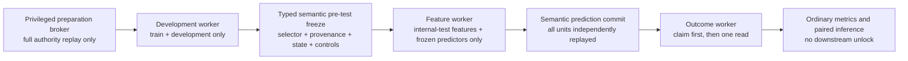

# ADR-0002：ordinary confirmatory run 采用能力隔离、语义冻结与一次性结局释放

## Status

`PROPOSED_NOT_ACTIVE`。

本 ADR 只定义新的 ordinary-only 执行边界。旧 monolithic runner、旧 full `StagedActivation`、hash-only `PRE_TEST_FREEZE_COMMIT` 和 hash-only `TEST_PREDICTION_COMMIT` 均不得因本 ADR 自动恢复。真实训练、internal-test 访问、合同变更、O0/G1/E0 或 sealed 访问仍未解锁。

## Context

ADR-0001 正确要求 train/development、internal-test feature 和 internal-test outcome 物理分离，但实现审计发现两个尚未闭合的缺口。

第一，旧 `DevelopmentDisclosure` 仍把三份 authority 的路径、SHA-256 和 inode 保存在同一个 Python 对象中。即使 helper 没有主动打开 test 文件，同一进程仍可以直接 `open()`，所以这不是能力隔离。

第二，旧 pre-test freeze 和 prediction commit 只核对引用、字节摘要与单元数量。四字段伪 selector、四字段伪 predictor provenance 和任意 checkpoint/prediction 字节也能形成完整 commit DAG。哈希图可重放只能证明“这些字节没变”，不能证明“模型、选择器、负对照和预测来自冻结方法且可独立复算”。

本路线的科学目标是先在 ordinary 数据上执行论文级强基线，再执行 Route A，只有 A 通过预冻结停止规则才允许 Route B。confirmatory internal-test 必须在以下内容全部冻结之后才能看到 feature：

- exact 八个同信息集 baseline 的开发集证据与 strongest-baseline selector；
- A、A matched control 和 B 的开发集 checkpoint-selection、五 seed state 与 predictor provenance；
- 所有必需 train-only negative controls；
- information-set fingerprint、estimand、component split、row set、代码与配置；
- `macro sign accuracy >= 0.60`，且该门槛不可降级或替代。

## Decision

采用 privileged preparation broker 加三个不同操作系统能力域的单向流程。进程之间只传不可变、最小化、stage-specific manifest；不传 full activation，也不共享包含三阶段数据的 run root。

### 1. Privileged preparation broker

只有 broker 可以读取旧 full activation 和完整 authority graph。它必须完成 source bytes、typed-safe authority、rich row projection、trusted code snapshot、execution qualification 和 row-firewall 的 exact replay。broker 不训练、不选择模型、不读取 ordinary internal-test outcome。

broker 签发的 development artifact 不得包含：

- old activation ref/path/SHA；
- internal-test feature/outcome path、SHA、inode、FD、row ID、support 或 count；
- sealed、restricted 或 `GSE246381` 引用；
- full authority bytes；
- caller-provided arbitrary metadata/payload。

若操作系统 mount/ACL/user 隔离、producer independence、append-only namespace 或证书预绑定尚未证明，状态必须保持 `HOLD`；代码 hash 或 synthetic smoke 不能自行升级为 training capability。

### 2. Development stage capability

development worker 只能看到：

- train/development outcome authority；
- 三份 rich development row projections；
- 七份 authority-specific typed development-safe projections；
- exact trusted code snapshot 与 execution qualification；
- development output namespace。

development worker 的 namespace 必须使任意 `stat/open/mmap` test feature、test outcome 或 sealed authority 得到 `ENOENT`/`EACCES`。等价的加密能力方案也可接受：worker 可以看到密文，但 feature/outcome 解密密钥必须分别由外部 key broker 托管，并且只有在相应 commit durable publication 后才能一次性释放。仅从函数参数中删除路径、把路径改名或把密钥放在同一用户可读环境中都不算满足。

其输出限定为 development-only artifacts：baseline fit/prediction evidence、checkpoint-selection、checkpoint state、predictor provenance、pre-test control registry 与 train/development-only control evidence、strongest-baseline selector 和 typed predictor-unit registry。post-outcome control summary 不得进入 pre-test freeze，也不得计算或记录 internal-test support。

### 3. Typed semantic pre-test freeze

旧 `staged_commits` 仅保留为 `HASH_GRAPH_REPLAY_ONLY` primitive；它不能直接解锁任何数据。

新的 freeze 必须从 exact typed paired policy 派生 baseline set 和顺序，调用者不能传入任意 subset、extra method 或自报 strongest baseline。exact baseline set 为：

1. `ZERO_DELTA`
2. `SOURCE_COMPONENT_BALANCED_TRAIN_PRIOR`
3. `EDIT_ONLY_RIDGE`
4. `CANDIDATE_KMER_RIDGE`
5. `PAIRED_LOCAL_GLOBAL_KMER_RIDGE`
6. `PAIRED_FEATURE_NEAREST_NEIGHBOR`
7. `HISTOGRAM_GRADIENT_BOOSTING`
8. `FULL_PAIR_UNRESTRICTED_SIAMESE`

predictor unit 使用显式类型，而不是 method/control × estimand × five-seed 笛卡尔积：

- `SCALAR_FIT`：一个冻结 fitted state；
- `NEURAL_SEED`：每个 neural method/estimand 恰好五个冻结 seed；
- `CONTROL_RUN`：有可重放 manifest、state、prediction 和 verifier；
- `CONTROL_NOT_RUN`：仅表示未运行，永远不能满足 required-control freeze。

freeze coordinator 必须逐项 strict replay：

- typed paired policy、method policy 和 optimizer/seed policy；
- development baseline selector；
- predictor provenance 与独立 verifier registry；
- checkpoint-selection envelope；
- development checkpoint envelope 与 opaque model state；
- pre-test control registry、train/development-only control evidence 及独立 verifier；post-outcome control summary 不得用于 freeze；
- active broken-pair policy/manifest（若该 control 被要求）。

任一 required control 为 inactive、`NOT_RUN`、缺 verifier 或无法重算，整个 freeze 为 `HOLD`。四字段伪 artifact、任意 checkpoint bytes、legacy schema 和 self-reported PASS 必须在 feature authority 第一次可见之前失败。

### 4. Internal-test feature stage capability

feature worker 只持有：

- typed semantic pre-test freeze ref；
- internal-test feature authority；
- inclusion/crosswalk/split 三份 feature-safe rich projections；
- prediction output namespace。

manifest 不重复 selected method、eligible order、checkpoint map 或 mutable config；这些只能由 freeze replay 得到。feature worker 看不到 train/development outcome、internal-test outcome 或 sealed authority。

所有冻结 unit 必须对同一 target-free row set 产生 canonical prediction。row identity 从 feature bytes重算，不接受 caller-supplied 64-hex ID。semantic prediction commit 必须独立重跑每个 predictor，并 exact compare unit prediction bytes，再重建 aggregate ensemble；hash-only prediction bundle 不能解锁 outcome。

### 5. Internal-test outcome release capability

outcome worker 只持有：

- semantic test-prediction commit ref；
- internal-test outcome authority；
- outcome row-set commitment；
- exclusive release-claim namespace。

它看不到 test feature、train/development data、模型 state、selector 或可变配置。流程为：

1. strict replay semantic prediction commit；
2. 验证 prediction 与 outcome row set exact match；
3. `O_CREAT|O_EXCL` 写 release claim；
4. `fsync` claim 与父目录；
5. 第一次且仅一次读取 ordinary outcome；
6. crash 或失败后拒绝重试；
7. 计算 ordinary metrics/paired inference，但保持 `sealed_access=false`、`downstream_unlock=false`。

ordinary outcome 一次性读取不等于 sealed one-shot，也不能自动解锁 E0。

### 6. Legacy entrypoints

以下类型的旧入口继续 unconditional `HOLD` 或 test/archive-only：

- monolithic activation validator/runner；
- 能同时收到 development 与 internal-test rows 的训练函数；
- 在 selector freeze 前计算 test sign support 的代码；
- 把 full authority bytes复制到共享 run root 的 helper；
- 只做 ref/hash replay却能触发 disclosure 的 writer/loader；
- 同一对象暴露三份 data authority 的 API。

新流程使用全新 stage-specific entrypoints，不能在“未来 v3 校验通过”后落回旧 continuation。

## Consequences

### Positive

- development 进程在操作系统层面没有读取 test 的能力，而不是仅承诺“不读取”。
- baseline/seed/control 选择在 test feature 披露前完成；outcome 披露前所有预测已独立复算并冻结。
- hash、schema、scientific semantics 和 OS capability 成为四个独立证据层，任何一层不能替代另一层。
- 强基线、A、A-control 与 B 可以在相同 row set、information set、estimand 和 component split 下做可审计配对比较。

### Negative

- 需要独立 producer/broker、三个 worker 身份或 mount namespace，以及额外部署配置；纯 Python 单进程测试不能完成最终资格证明。
- artifact graph 更大，训练前置时间和维护成本上升。
- 当前 negative-control 路线中仍有 scientifically undefined/inactive 项，因此 pre-test freeze 可能继续 HOLD，直到预注册替代控制被激活。

### Neutral

- synthetic fixture、compile/test 通过、HGB smoke、checkpoint replay 和 code SHA 只证明对应工程性质；均不产生 effect GO。
- 在真实 ordinary authority 未冻结并完成 OS 隔离前，项目可以继续做开发集模型改进，但不能称 confirmatory benchmark。

## Alternatives Considered

### 单进程但隐藏 test 路径字段

拒绝。同一进程可扫描文件系统、环境变量和 FD；隐藏 Python 属性不是 capability separation。

### 继续使用 hash-only staged commit

拒绝。任意字节也能被哈希；这只能证明不可变，不能证明 predictor 或 selector 语义。

### 在 outcome release 时才验证模型

拒绝。此时 test feature 已可见，容易产生结果后修补或重算；模型语义必须在 feature 披露前冻结。

### required control 为 NOT_RUN 时仍允许 freeze

拒绝。`NOT_RUN` 是缺失证据，不是 PASS；如控制科学上不可定义，应先版本化修订 policy，而不是在执行时降级。

### 用代码哈希证明无信息泄漏

拒绝。hash 证明字节一致，不证明代码无语义或隐蔽信道；仍需独立审查与 OS 权限边界。

## Activation Criteria

本 ADR 只有在以下条件全部满足后才可由用户另行批准为 active：

1. development artifact 递归扫描不含任何 test path/hash/inode/FD/support/count；
2. development 子进程直接尝试打开 test feature/outcome/sealed 时得到 `ENOENT`/`EACCES`；
   若采用加密能力方案，则必须证明该进程没有 feature/outcome 解密密钥，且外部 key broker 在对应 commit 前拒绝释放；
3. exact 八 baseline 的开发证据与 selector 可由独立 verifier 重算；
4. typed unit registry、所有 checkpoint-selection/state/provenance/control 可严格 replay；
5. required control 无 `NOT_RUN`/inactive/缺 verifier；
6. feature worker看不到 outcomes，outcome worker看不到 features/models；
7. prediction commit逐 unit重算，outcome claim-before-read 与 crash-no-retry 对抗测试通过；
8. sign gate 在所有阶段固定为 `0.60`；
9. sealed、O0、G1、E0 与 downstream unlock 继续为 false；
10. 真实 ordinary authority 路径、bytes 和 deployment mount policy 在访问前冻结。

## References

- `docs/adr/0001-staged-ordinary-disclosure.md`
- `docs/plans/2026-08-07-r3-ordinary-critic-route.md`
- `scripts/r3x/staged_disclosure.py`
- `scripts/r3x/staged_commits.py`
- `scripts/r3x/typed_safe_authorities.py`
- `scripts/r3x/stage_row_projections.py`
- `scripts/r3x/development_checkpoint.py`
- `scripts/r3x/predictor_provenance.py`
- `scripts/r3x/baseline_selection.py`
- `scripts/r3x/activation_trust.py`
- `scripts/r3x/trusted_execution.py`
- `scripts/r3x/typed_pretest_freeze.py`
- `scripts/r3x/pretest_control_registry.py`
- `scripts/r3x/test_stage_capabilities.py`
